<picture><source media="(prefers-color-scheme: dark)" srcset="assets/header-dark.svg"></picture>

<a href="https://ezz-shashiii.vercel.app"><picture><source media="(prefers-color-scheme: dark)" srcset="assets/link-portfolio-dark.svg"></picture></a>
<a href="https://ezz-shashiii.vercel.app/resume"><picture><source media="(prefers-color-scheme: dark)" srcset="assets/link-resume-dark.svg"></picture></a>
<a href="https://www.linkedin.com/in/shashikant-rajput"><picture><source media="(prefers-color-scheme: dark)" srcset="assets/link-linkedin-dark.svg"></picture></a>
<a href="mailto:shashi2005.pvt@gmail.com"><picture><source media="(prefers-color-scheme: dark)" srcset="assets/link-email-dark.svg"></picture></a>

<picture><source media="(prefers-color-scheme: dark)" srcset="assets/section-projects-dark.svg"></picture>

<a href="https://ezz-shashiii.vercel.app/work/non8"><picture><source media="(prefers-color-scheme: dark)" srcset="assets/card-non8-dark.svg">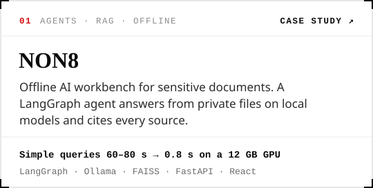</picture></a>
<a href="https://github.com/codeseeboy/clausewise"><picture><source media="(prefers-color-scheme: dark)" srcset="assets/card-clausewise-dark.svg"></picture></a>

<a href="https://github.com/codeseeboy/urban-fix-ai"><picture><source media="(prefers-color-scheme: dark)" srcset="assets/card-urbanfix-dark.svg">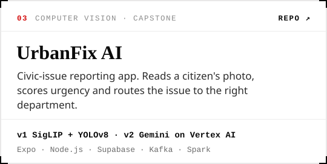</picture></a>
<a href="https://github.com/codeseeboy/Trust-layer-AI"><picture><source media="(prefers-color-scheme: dark)" srcset="assets/card-trustlayer-dark.svg"></picture></a>

<a href="https://github.com/codeseeboy/countX"><picture><source media="(prefers-color-scheme: dark)" srcset="assets/card-countx-dark.svg">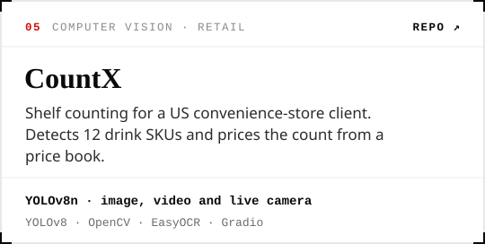</picture></a>
<a href="https://github.com/codeseeboy/llm-backend"><picture><source media="(prefers-color-scheme: dark)" srcset="assets/card-llm-gateway-dark.svg"></picture></a>

<a href="https://github.com/codeseeboy/game-theory-capstone"><picture><source media="(prefers-color-scheme: dark)" srcset="assets/more-gridlock-dark.svg"></picture></a>
<a href="https://github.com/codeseeboy/addX"><picture><source media="(prefers-color-scheme: dark)" srcset="assets/more-addx-dark.svg"></picture></a>
<a href="https://github.com/codeseeboy/beverage-bottle-detection-model"><picture><source media="(prefers-color-scheme: dark)" srcset="assets/more-bottles-dark.svg"></picture></a>

<picture><source media="(prefers-color-scheme: dark)" srcset="assets/career-dark.svg"></picture>

<picture><source media="(prefers-color-scheme: dark)" srcset="assets/stack-dark.svg"></picture>

<a href="mailto:shashi2005.pvt@gmail.com"><picture><source media="(prefers-color-scheme: dark)" srcset="assets/footer-dark.svg"></picture></a>
